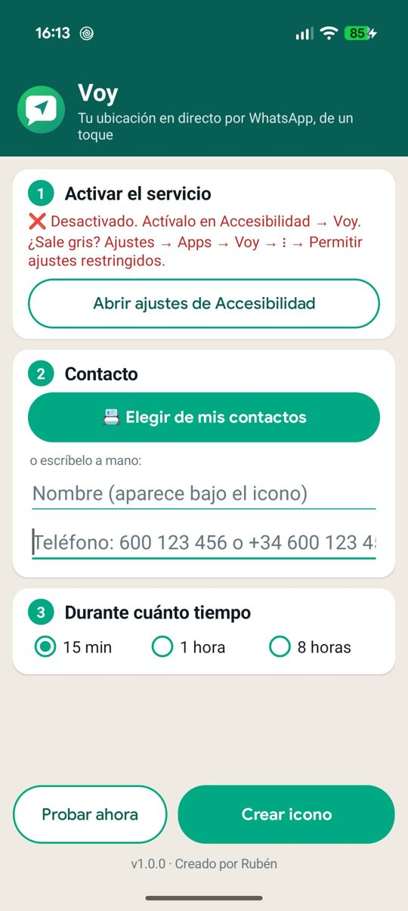
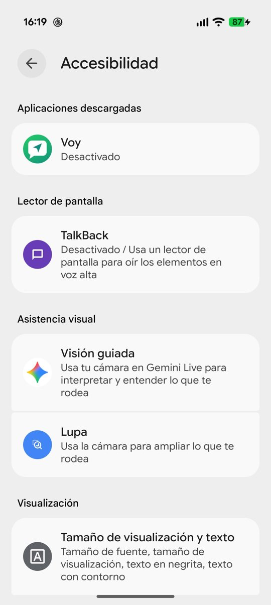
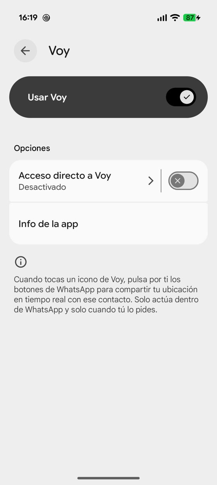

<h1 align="center">Voy</h1>

**Your live location on WhatsApp, in one tap.** Add an icon for a contact to your home screen; tap it and Voy starts sharing your live location with that person on WhatsApp.

  
  &nbsp;
  

<b>👉 <a href="https://github.com/neoruben/Voy/releases/latest">Download Voy</a></b> — open the page, tap the <code>Voy-x.y.z.apk</code> file under <i>Assets</i> and install it on your phone.

Free and open-source Android app.

> **Unofficial app.** Not affiliated with, sponsored or endorsed by WhatsApp or Meta. WhatsApp is a trademark of its owner and is used only to indicate compatibility.

*[Versión en español más abajo](#-en-español)*

## Features

- One home-screen icon per contact, with the contact's photo (or initials) and the label *Voy + name*.
- One tap: Voy opens the chat and taps *Attach → Location → Share live location → duration → Send* for you, then goes back to the home screen.
- Choose how long to share: 15 minutes, 1 hour or 8 hours.
- Pick the contact from your address book or type the number by hand (the country code is added automatically).
- Works with WhatsApp and WhatsApp Business in English, Spanish, Italian and French.
- App in English, Spanish, Italian and French (follows your phone's language).

## How it works

1. **Turn on the service.** Open Voy and tap **Open Accessibility settings**. Find **Voy** under *Downloaded apps* and turn on **Use Voy**.
   If the switch is greyed out (Android 13 and newer, for apps installed outside Google Play): *Settings → Apps → Voy → ⋮ → Allow restricted settings*, then try again.

   

     
     
   

2. **Pick a contact** with **Pick from my contacts**, or type the name and phone number.
3. **Choose the duration** and tap **Add icon**. Confirm in the dialog and place the icon on your home screen.
4. **Tap the icon** whenever you want to share your location. You'll see WhatsApp's menus flash by for 2–3 seconds; then you're back on the home screen and a message confirms it.

WhatsApp has no API to start live location from another app, so Voy uses an Android **accessibility service** that finds WhatsApp's buttons on screen and taps them. It only acts inside WhatsApp and only when you tap one of its icons.

## Installation

1. Download the latest `Voy-x.y.z.apk` from **[the download page](https://github.com/neoruben/Voy/releases/latest)** (under *Assets*).
2. Open it on your phone. Android will ask you to allow installing from that app (browser or file manager): accept.
3. Open Voy and follow the steps above.

Requires Android 8.0 or newer.

## Permissions and privacy

| Permission | Why |
|---|---|
| Accessibility | To tap WhatsApp's buttons for you |
| Contacts (optional) | To put the contact's photo on the icon. If you deny it, the icon shows their initials |

- The app **doesn't collect or send any data**. No servers, no ads, no analytics.
- Your location is shared by WhatsApp itself, exactly as if you did it by hand.

## Limitations

- The phone must be unlocked.
- If WhatsApp changes the text of its buttons, Voy may stop working until it's updated. If it gets stuck, it gives up after a few seconds and asks you to finish by hand: it never sends anything else.
- Developers: filter Logcat by `tag:Voy` to see what the service finds on screen.

## Building

Open the project in Android Studio and press **Run**.

## License

[MIT](LICENSE)

---

## 🇪🇸 En español

**👉 [Descargar Voy](https://github.com/neoruben/Voy/releases/latest)** · ☕ [Invítame a un café](https://ko-fi.com/onerate)

**Voy** comparte tu ubicación en tiempo real por WhatsApp **de un solo toque**. Añades a la pantalla de inicio un icono por contacto; al tocarlo, Voy empieza a compartir tu ubicación en directo con esa persona. Es una app para Android, gratuita y de código abierto.

> **App no oficial.** No está afiliada, patrocinada ni respaldada por WhatsApp ni por Meta.

**Funciones**

- Un icono por contacto, con su foto (o sus iniciales) y el texto *Voy + nombre*.
- Un toque: Voy abre el chat y pulsa por ti *Adjuntar → Ubicación → Compartir ubicación en tiempo real → duración → Enviar*, y vuelve a la pantalla de inicio.
- Duración a elegir: 15 minutos, 1 hora u 8 horas.
- Elige el contacto de tu agenda o escribe el número a mano (el prefijo del país se añade solo).
- Funciona con WhatsApp y WhatsApp Business en español, inglés, italiano y francés.

**Cómo funciona**

1. **Activa el servicio.** Abre Voy y pulsa **Abrir ajustes de Accesibilidad**. Busca **Voy** en *Aplicaciones descargadas* y activa **Usar Voy**.
   Si el interruptor sale gris (Android 13 o superior, con apps instaladas fuera de Google Play): *Ajustes → Apps → Voy → ⋮ → Permitir ajustes restringidos* y vuelve a intentarlo.

   

     
     
   

2. **Elige un contacto** con **Elegir de mis contactos**, o escribe el nombre y el teléfono.
3. **Elige la duración** y pulsa **Crear icono**. Confirma en el aviso y coloca el icono en la pantalla de inicio.
4. **Toca el icono** cuando quieras compartir tu ubicación. Verás pasar los menús de WhatsApp durante 2–3 segundos; luego vuelves a la pantalla de inicio y un aviso lo confirma.

WhatsApp no tiene ninguna API para iniciar la ubicación en tiempo real desde otra app, así que Voy usa un **servicio de accesibilidad** de Android que localiza los botones de WhatsApp en pantalla y los pulsa. Solo actúa dentro de WhatsApp y solo cuando tocas uno de sus iconos.

**Instalación**

1. Descarga el último `Voy-x.y.z.apk` desde **[la página de descarga](https://github.com/neoruben/Voy/releases/latest)** (en *Assets*).
2. Ábrelo en el móvil y acepta instalar desde esa app (navegador o gestor de archivos).
3. Abre Voy y sigue los pasos de arriba.

Requiere Android 8.0 o superior.

**Permisos y privacidad:** usa el permiso de accesibilidad para pulsar los botones de WhatsApp y, de forma opcional, el de contactos para poner la foto en el icono (si lo deniegas, salen las iniciales). La app no recoge ni envía ningún dato: sin servidores, sin anuncios, sin analíticas.

**Limitaciones:** el móvil tiene que estar desbloqueado. Si WhatsApp cambia los textos de sus botones, Voy puede dejar de funcionar hasta que se actualice; si se atasca, se detiene a los pocos segundos y te pide terminarlo a mano, nunca envía nada más.
